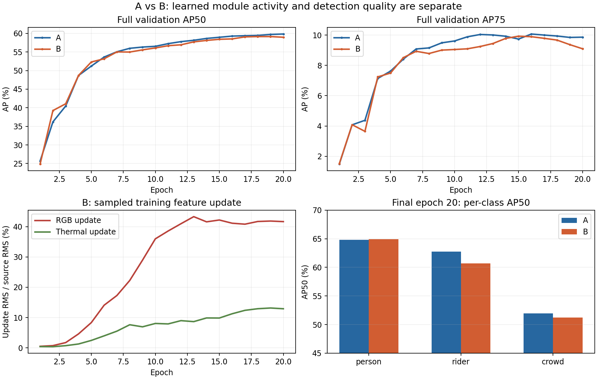

# 이전 B가 A보다 낮았던 결과의 분석

이 분석은 **HybridEncoder 처리 이후 P3에 양방향 residual MoFE를 붙인 이전 B**에 한정한다.
현재의 pre-pyramid 위치 변경 실험 결과를 섞지 않는다.

## 전체 검증에서 확인한 저하

최고 AP50은 A epoch 20의 59.8387%, B epoch 18의 59.1529%다.
최고점 차이는 −0.6858 percentage point이며, 마지막 epoch 20끼리는 −0.8695다.
B가 epoch 5에서는 A보다 AP50이 약 1.10 point 높았지만 마지막에는 역전됐다.
초기 우위가 최종 개선을 보장하지 않았음을 보여준다.

마지막 epoch 20의 전체 검증 클래스별 값은 다음과 같다.
최고 B의 epoch 18 클래스별 수치로 해석하면 안 된다.

| 클래스 | A AP50 (%) | B AP50 (%) | B−A (point) | A AP75 (%) | B AP75 (%) |
|---|---:|---:|---:|---:|---:|
| person | 64.8400 | 64.9433 | +0.1032 | 7.3287 | 7.4080 |
| rider | 62.7396 | 60.7102 | −2.0293 | 8.5775 | 6.8042 |
| crowd | 51.9364 | 51.2539 | −0.6825 | 13.6910 | 13.0841 |

AP50은 세 클래스 평균이므로 person의 작은 개선보다 rider/crowd의 손해가 크게 반영됐다.
이는 [공식 방식의 최종 클래스별 AP](results/final_class_AP.json)가 저장된 전체 AP와
일치하는지 확인한 결과다.

같은 마지막 checkpoint prediction을 score≥0.1에서 greedy matching한 보조 진단에서는
rider FP가 19,928→21,296, IoU≥0.75 TP가 399→358로 바뀌었다.
이 진단은 고정 threshold의 오류 개수이며 공식 AP 계산과 다르다.
`background_or_class` 집계만으로 배경 오탐과 클래스 혼동을 분리해 확정할 수 없다.
검증에서 rider의 정밀도와 높은 IoU의 검출이 악화된 정황을 보여준다.

## Expert가 학습되지 않은 문제인가

학습 전 실제 GPU 2-step 확인에서 module parameter tensor **36개 전부**가
유한하고 0이 아닌 gradient를 받아 갱신됐다. 최고 B checkpoint 진단에서도
expert/router/gamma 파라미터 변화와 유한한 Adam moment를 확인했다.
따라서 단순한 optimizer 누락이나 모든 expert 경로의 gradient 단절은 관측되지 않았다.

최고 B epoch 18 EMA의 24장 진단에서 γRGB≈0.2076, γThermal≈0.1289였다.
실제 residual의 원본 특징 대비 RMS 비율은 평균 RGB≈43.89%, thermal≈9.31%였다.
초기 γ=0.1이었다는 사실만으로 학습 후 보완량도 작다고 판단할 수 없다.
이 값이 크다는 사실 자체가 성능 저하 원인임을 입증하지는 않는다.

같은 24장의 router 평균 가중치는 RGB 방향
`[0.0899, 0.2601, 0.2650, 0.3851]`, thermal 방향
`[0.2452, 0.0609, 0.3120, 0.3818]`였다.
모든 expert가 동일하게 선택되거나 하나만 항상 선택되는 형태는 아니었다.
그러나 가중치가 변한다는 것과 탐지에 유리한 expert를 선택한다는 것은 별개다.

## 모듈을 끄거나 선택을 바꾸면 어떠했는가

최고 B EMA에서 evenly spaced validation index 24개를 선택했다.
전체 1,225장 결과와 구분해야 하며, 이 subset에서는 A보다 B의 AP50이 높아
전체 검증의 순위와도 달랐다.

| 같은 24장 조건 | AP50 (%) | AP75 (%) |
|---|---:|---:|
| A checkpoint | 53.4475 | 7.7417 |
| B 원래 혼합 | 55.1768 | 8.5042 |
| B uniform 혼합 | 54.4343 | 9.1091 |
| B 모듈 off | 49.6791 | 4.6789 |

B에서 보완을 끄면 낮아졌으므로 학습된 B가 이 경로를 활용한다는 정황은 있다.
하지만 **B를 학습한 뒤 끈 모델은 모듈 없이 학습한 A가 아니다**.
공동 적응 때문에 B-off 결과로 B가 A보다 좋다는 결론을 낼 수 없다.
AP50과 AP75에 따라 uniform/learned routing의 상대 순위도 달랐다.

네 expert 중 같은 조합 하나를 양방향에 강제한 결과를 GT 기반으로 사후 선택하면,
24장 중 19장에서 원래 혼합보다 final-decoder detection cost가 낮았다.
평균 cost는 1.3426→1.3097이다. 각 variant에서 matching을 다시 계산한
VFL+가중 L1/GIoU 기준이며, 전체 학습 loss나 고정 matching utility 목표가 아니다.
GT를 이용한 사후 oracle이므로 배포 가능한 선택법이나 AP 개선의 증거가 아니다.
현재 router가 탐지 cost 관점에서 항상 최선이라는 근거가 부족하다는 진단이다.

## 원인 후보와 아직 확정할 수 없는 부분

1. **이미지별 선택의 한계:** 한 이미지의 tiny 객체와 배경이 같은 네 가중치를 쓴다.
   객체 위치별로 필요한 주파수가 달라도 router가 그 차이를 직접 표현하지 못한다.
   이는 구조적 제약이며, 위치별 선택으로 AP가 오른다는 인과 검증은 아직 없다.
2. **P3 보완이 pyramid 처리 이후에만 들어감:** RGB/T P3가 변해도 P4/P5는
   기존 encoder 결과 그대로 fusion한다. 전후 scale 간 특징 관계가 어떻게 영향을 받았는지는
   삽입 위치만 바꾸는 대조 실험이 필요하다.
3. **보완 후보의 크기와 탐지 목적의 적합성:** 상대적으로 큰 RGB residual,
   rider/crowd 손해, AP75 저하는 보완 특징의 탐지 품질을 더 확인할 이유다.
   양방향, convolution expert, residual scale 중 어느 하나가 단독 원인인지는 분리하지 못했다.

Stride-one Haar는 추가 spatial downsampling 없이 네 밴드를 유지한다.
`(LL+LH+HL+HH)/2`로 입력을 복원하는 CPU 점검의 최대 오차는 약 4.77e−7이었다.
따라서 이 구현의 SWT가 해상도를 줄여 정보를 버린다는 설명은 맞지 않는다.
채널 projection과 학습된 expert 혼합 이후의 정보 유용성까지 보장하는 결과는 아니다.

훈련 마지막 epoch에서 로그에 남은 123개 batch의 sample mean loss는 B가 A보다
조금 낮았고 L1/GIoU도 낮았다. 전체 2,450개 batch의 평균을 계산한 값은 아니다.
훈련 cost 개선이 검증 AP 개선으로 이어지지 않았다는 관측이다.
이 사실만으로 과적합 또는 분류 loss 문제를 유일한 원인으로 확정할 수 없다.

결론은 **이전 B는 모듈 경로를 실제로 학습했지만, 동일 조건에서 A를 넘는 검출 성능은
확인하지 못했다**는 것이다. SOD와 detection의 차이, 단방향/양방향, RCFA 유무,
attention/conv 여부를 이 결과 하나만으로 원인으로 단정하지 않는다.

근거: [전체 비교](results/comparison.json), [학습 epoch 요약](results/B_training_epoch_summary.json),
[최고 B 24장 진단](results/cpu_probe.json), [최종 클래스 오류](results/old_B_class_error_analysis.json),
[Haar 점검](results/haar_reconstruction_check.json).
