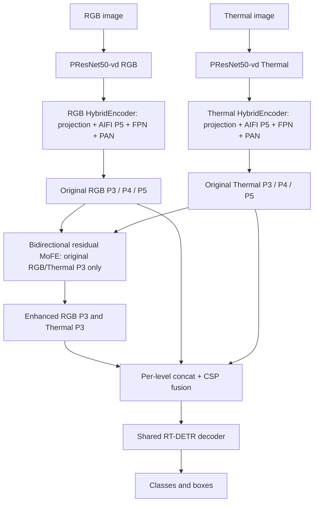

# Dual-stream RT-DETR + 양방향 residual MoFE: 이전 실험 B

RGBTDronePerson에서 **이전 B는 dual-stream RT-DETR인 A의 최고 성능을 넘지 못했다.**
동일 seed 0, batch 2, 20 epoch로 각각 처음부터 학습한 결과를 보존한다.
이 폴더는 기존 COXNet/MMDetection 구현과 독립적으로 실행한다.

| 모델 | AP50 최고 epoch | AP50 (%) | AP75 (%) | tiny AP50 (%) |
|---|---:|---:|---:|---:|
| A: dual-stream RT-DETR | 20 | 59.8387 | 9.8657 | 61.3414 |
| B: A + 양방향 residual MoFE | 18 | 59.1529 | 9.6739 | 60.8362 |
| B: 마지막 checkpoint | 20 | 58.9691 | 9.0988 | 60.9391 |

AP50로 고른 최고 checkpoint끼리 B의 AP50은 **0.6858 percentage point 낮다**.
마지막 20 epoch끼리 차이는 **−0.8695 percentage point**다.
AP75 열도 AP50로 선택한 같은 checkpoint의 값이며, AP75 기준 최고점을 따로 고른 표가 아니다.
검증은 전체 1,225장, person/rider/crowd 3개 클래스, EMA, RGBTDronePerson tiny 평가,
`maxDets=1000`이다. 이 AP50/AP75는 COCO AP50:95와 다르다.
단일 seed 결과이므로 통계적 유의성이나 모든 MoFE 설계의 실패를 주장하지 않는다.
정확한 수치는 [comparison.json](results/comparison.json)에 있다.

## 어떤 B를 보존하는가

**두 HybridEncoder의 AIFI/FPN/PAN 처리가 끝난 P3를 강화하는 이전 B**다.
그 이후에 진행한 projection 직후·pyramid 처리 이전의 B-pre, Mamba, uncertainty,
utility 감독 실험은 이 결과에 포함하지 않는다.



그림의 직접 연결은 원래 P4/P5를 전달하는 경로다. P3는 강화한 결과로 교체한다.
512×640 입력의 P3는 stride 8, `B×256×64×80`이다.

각 방향은 별도 parameter bank를 가진다. RGB 강화와 thermal 강화는 모두 **원래 입력 쌍**에서
계산하며, 먼저 강화한 RGB를 thermal 방향의 입력으로 재사용하지 않는다.

1. 각 bank의 1×1 projection으로 256→64 채널로 바꾼다. 한 bank 안에서는 두 모달리티가
   같은 projection을 사용하며, 반대 방향 bank와는 파라미터를 공유하지 않는다.
2. Signed stride-one Haar 분석으로 공간 크기를 유지한 LL/LH/HL/HH를 만든다.
   `L=LL`, `H=concat(LH, HL, HH)`로 정의한다.
3. 수신 모달리티/전달 모달리티의 `L-L`, `L-H`, `H-L`, `H-H` 조합을 네 expert에 넣는다.
   Expert는 `1×1 Conv → GELU → 3×3 depthwise Conv → GELU → 1×1 Conv`이며
   내부 64채널, 출력 256채널이다.
4. 조합 특징을 concat한 router가 `1×1 Conv → GELU → global average pool → 1×1 Conv`
   후 FP32 softmax로 **이미지별** 네 가중치를 만든다. 위치별 router가 아니다.
5. 각 방향의 혼합 보완량을 원본 P3에 더한다.

\[
R^+ = R + \gamma_R\sum_{i=1}^{4}p_i E_i(R,T),\qquad
T^+ = T + \gamma_T\sum_{i=1}^{4}q_i \widetilde E_i(T,R).
\]

`γ_R`, `γ_T`는 0.1로 시작하는 학습 가능한 scalar이며 범위 제한은 없다.
모든 expert를 계산하는 dense mixture다. 모듈 내부에는 QKV cross-attention이 없다.
**S³AM의 주파수 조합 아이디어를 옮긴 구현**이며 expert의 세부 convolution 구성은
이 실험의 구현 선택이다. 저자 코드와의 완전한 동일성이나 RCFA/HSSD를 포함한
전체 S³AM 재현을 주장하지 않는다.

주요 코드: [residual_mofe.py](dyfclt/residual_mofe.py),
[s3am_mofe.py](dyfclt/s3am_mofe.py), [dual_encoder.py](dyfclt/dual_encoder.py).
기존 클래스 이름 `DyFCLT`는 scaffold 이름이며, 여기서는 `architecture: dual_rtdetr`로
DFCA/SSE/FREF/mask loss를 끈다. 보존된 소스에는 과거 선택 경로도 있지만 제공한 A/B 설정은
teacher, distillation, utility, evidence, Mamba를 실행하지 않는다.

## 재현 설정과 실행

| 항목 | A와 B 공통 설정 |
|---|---|
| 학습 | seed 0, batch 2, workers 4, FP32, 20 epoch / 49,000 updates |
| 초기화 | 두 backbone에 동일한 공개 PResNet50-vd 사전학습 가중치; 학습한 A/B checkpoint를 불러오지 않음 |
| Optimizer | AdamW, LR 2.5e−4, backbone LR 2.5e−5, weight decay 1e−4 |
| LR/EMA | linear warmup 2,000 steps, 초기 factor .001, 이후 일정 LR; EMA .9999 / warmups 2,000 |
| Gradient clip | global norm .1 |
| 입력 크기 | train 448×576 / 512×640 / 576×704, eval 512×640 |
| Detection loss | VFL 1 + L1 5 + GIoU 2, 기존 encoder/decoder auxiliary 및 denoising loss |
| Decoder | 300 queries, 6 layers, denoising 100 |
| 파라미터 | A 84,854,961 / B 85,286,203; 추가 모듈 431,242 |

이 실험은 Torch 1.13.1+cu116 / torchvision 0.14.1+cu116 / Python 3.9에서 학습했다.
저장소 루트의 COXNet용 Torch 1.10/MMCV 환경과 별도 환경을 사용한다.

```bash
cd experiments/dual_rtdetr_mofe
# 별도 Python 3.9 환경에서 학습 당시 torch/torchvision을 먼저 설치한다.
pip install torch==1.13.1+cu116 torchvision==0.14.1+cu116 --extra-index-url https://download.pytorch.org/whl/cu116
pip install -r requirements.txt
```

데이터는 별도로 준비한다. YAML의 `data.*.ann_file`과 `image_root`를 실제 경로로 바꾸거나,
아래 위치에 데이터 폴더를 연결한다. Thermal-reference annotation을 사용하며 category 3
`uncertain`은 점수 산정 클래스에서 제외한다. 두 이미지 크기는 서로 같아야 한다.

```text
data/RGBTDronePerson/
  train_thermal.json
  val_thermal.json
  train/visible/   train/thermal/
  val/visible/     val/thermal/
```

공개 backbone 가중치는 [RT-DETR storage release](https://github.com/lyuwenyu/storage/releases/download/v0.1/ResNet50_vd_ssld_v2_pretrained_from_paddle.pth)에서
`weights/ResNet50_vd_ssld_v2_pretrained_from_paddle.pth`로 저장한다.
학습 당시 파일 SHA256은
`641dc59835d5228e6013ac45acb633592ec825144fb3d78055bc07699f404353`이다.

```bash
# 각각 별도 실행한다. CUDA_VISIBLE_DEVICES는 사용 가능한 물리 GPU에 맞춘다.
CUDA_VISIBLE_DEVICES=1 python -u tools/train.py --config configs/rgbtdroneperson_dual_rtdetr.yaml --device cuda:0
CUDA_VISIBLE_DEVICES=1 python -u tools/train.py --config configs/rgbtdroneperson_residual_mofe.yaml --device cuda:0

# best.pth에는 raw model과 EMA가 함께 저장된다. 비교에는 EMA를 사용한다.
CUDA_VISIBLE_DEVICES=1 python tools/evaluate.py \
  --checkpoint outputs/rgbtdroneperson_residual_mofe_seed0/best.pth \
  --config configs/rgbtdroneperson_residual_mofe.yaml --weights ema \
  --device cuda:0 --output-dir outputs/B_best_validation

OMP_NUM_THREADS=2 MKL_NUM_THREADS=2 OPENBLAS_NUM_THREADS=2 python -m unittest discover -s tests -v
```

명령은 이 실험 폴더에서 실행한다. 기존 `last.pth`가 있는 출력 경로에는 새 학습을
덮어쓰지 않으며, 이어 학습하려면 `--resume`을 사용한다.
`configs/rgbtdroneperson.yaml`은 trainer의 기본 경로를 위한 B 설정 사본이다.

## 결과와 분석 자료

- [이전 B 분석](ANALYSIS_KO.md): 관측한 성능 저하와 아직 입증하지 못한 원인.
- [전체 검증 비교](results/comparison.json), [A epoch별 검증](results/A_validation_history.json),
  [B epoch별 검증](results/B_validation_history.json): 원본 학습 console의 전체 검증 행을 추출했다.
- [마지막 epoch 클래스별 AP](results/final_class_AP.json),
  [오류 진단](results/old_B_class_error_analysis.json).
- [최고 B의 24장 counterfactual 진단](results/cpu_probe.json),
  [12장 train/eval·raw/EMA 진단](results/router_mode.json): 전체 검증과 분리해서 해석한다.
- [학습 전 검증](results/prelaunch_verification.json): 당시 36개 module parameter tensor의
  gradient/update와 A 공통 초기화 일치를 확인한 기록이다. 이 파일의
  `production_training_launched:false`, `AP_measured:false`는 **학습 전 시점**의 값이다.
  완료 상태와 AP는 `comparison.json`에 기록했다.
- [Source manifest](results/source_manifest.json): 게시한 모델·학습·평가 소스 34개 파일은
  B 학습 시작 시 저장한 snapshot과 byte 단위로 동일하다. YAML 데이터 경로와 테스트
  fixture의 이식성 변경은 따로 기재했다. 원래 실행 설정도 `results/*_original_config.json`에 보존했다.

데이터, 대용량 checkpoint와 전체 prediction 배열은 Git에 포함하지 않는다.
따라서 공개 자료만으로 저장된 weight의 전체 AP를 다시 계산할 수는 없으며,
재학습하거나 원래 checkpoint를 별도로 준비해야 한다. 기존 두 학습의 기록을 보존한
결과이고, 이번 업로드 과정에서 새로 20 epoch 학습한 결과는 아니다.

Vendored RT-DETR와 evaluator의 출처 및 라이선스는 [third_party](third_party/)에 있다.
