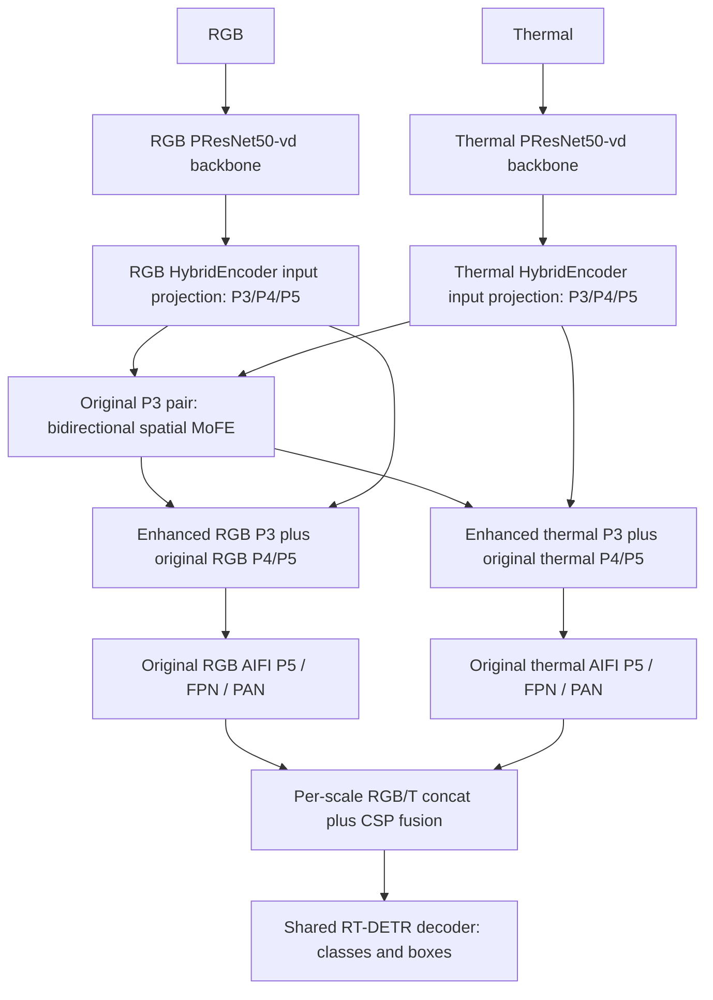

# Dual-stream RT-DETR + 위치별 양방향 MoFE

기존 [이전 B 실험](../dual_rtdetr_mofe/README.md)은 그대로 보존한다. 이 폴더는
공통 채널 projection 직후의 P3에 양방향 MoFE를 넣고, 각 위치마다 주파수 expert를
선택하는 새 실험이다. 기존 COXNet/MMDetection과 독립적으로 실행한다.

**새 spatial 모델의 최종 AP는 아직 측정하지 않았다.** GPU 1에서 seed 0, batch 2,
FP32, 20 epoch로 처음부터 학습을 시작했다. 게시 시점의 상태는
[training_status_snapshot.json](results/training_status_snapshot.json)에 기록했으며,
이는 자동으로 갱신되는 실시간 상태가 아니다.

## 구조와 변경 범위



Direct projection-to-encoder paths in the figure carry P4/P5. P3 is replaced
by the enhanced result. Enhancement enters both FPN and PAN, so it can affect
all final pyramid levels. The model does not use SSE.

두 방향은 **원래 RGB/T 입력 쌍**에서 각각 계산한다. 한 방향에서 이미 강화한 특징을
다른 방향에 재사용하지 않는다. 각 bank의 기존 256→64 projection과 네 expert를 유지한다.

1. Stride-one signed Haar/SWT 분석: LL, LH, HL, HH. `H=Concat(LH,HL,HH)`.
2. 수신/전달 모달리티의 LL–LL, LL–H, H–LL, H–H를 각각 concat하여 expert에 입력.
3. Expert: `1×1 Conv → GELU → 3×3 depthwise Conv → GELU → 1×1 Conv`.
   내부 64채널, 출력 256채널이다.
4. Router: `1×1 Conv → GELU → 1×1 Conv → FP32 softmax`.
   기존 이미지별 router의 global pooling을 제거한다.
5. `[B,2,4,H,W]` 가중치의 expert 축에서 합이 1이 되도록 혼합하고 원본에 residual로 더한다.

\[
R'(x,y)=R(x,y)+0.5\gamma_R\sum_{i=1}^4w_{R,i}(x,y)\Delta_{R,i}(x,y),
\]
\[
T'(x,y)=T(x,y)+0.5\gamma_T\sum_{i=1}^4w_{T,i}(x,y)\Delta_{T,i}(x,y).
\]

모든 expert를 계산하는 dense mixture다. `gamma_R/T`는 학습 가능한 scalar이며 초기값은
0.1이다. **0.5는 고정 multiplier**이므로 초기 유효 계수는 0.05다. Gamma나 expert 출력이
증가할 수 있으므로 최종 보완량 RMS가 기존의 절반으로 제한된다는 뜻은 아니다.
평균 가중치, 이미지 내부 공간 표준편차, entropy, 후보 RMS, 실제 relative update와
effective residual scale을 학습 로그에 기록한다.

이 concat은 **expert 입력의 주파수 pair 구성**이며, 뒤의 기존 detector RGB/T fusion과
별도 단계다. Expert 내부에는 QKV attention이 없다. S³AM 본문은 각 expert를 `E_n`으로
기술하므로 세부 convolution, 차원, 양방향 구성과 위치별 router는 우리의 적용 선택이다.
S³AM 전체 RCFA/HSSD 또는 저자 코드와 동일한 구현이라고 주장하지 않는다.

코드: [spatial_mofe.py](dyfclt/spatial_mofe.py),
[dual_encoder.py](dyfclt/dual_encoder.py), [HybridEncoder](dyfclt/vendor/hybrid_encoder.py).

## 같은 학습 조건

| 항목 | 설정 |
|---|---|
| 초기화 | 공개 PResNet50-vd pretrained; 학습한 A/B/E checkpoint를 로드하지 않음 |
| 학습 | seed 0, batch 2, workers 4, FP32, 20 epoch / 49,000 updates |
| Optimizer | AdamW, LR 2.5e−4, backbone LR 2.5e−5, weight decay 1e−4 |
| Warmup / EMA | 2,000 steps, factor .001; EMA .9999 / warmups 2,000 |
| Gradient clip | global norm .1 |
| 입력 | train 448×576 / 512×640 / 576×704; eval 512×640 |
| Detection loss | VFL 1 + L1 5 + GIoU 2 + 기존 auxiliary/denoising loss |
| 추가 loss | 없음; mask/utility/evidence/teacher/distillation loss를 실행하지 않음 |
| 파라미터 | 전체 85,286,203 / 모듈 431,242; B-pre와 동일 |
| 데이터 | train 4,900 / val 1,225; thermal-reference person/rider/crowd |

**B-pre 대비 router와 residual multiplier 두 항목이 함께 바뀐다.** 새 모델의 성능이
달라지더라도 각 항목의 효과를 분리하려면 동일 multiplier의 전역 router 대조가 필요하다.
그 대조 실험을 새로 학습했다고 기록하지 않는다.

## 재현

Python 3.9 / Torch 1.13.1+cu116 / torchvision 0.14.1+cu116에서 검증했다.
저장소 루트의 COXNet용 환경과 별도로 준비한다.

```bash
cd experiments/dual_rtdetr_spatial_mofe
pip install torch==1.13.1+cu116 torchvision==0.14.1+cu116 --extra-index-url https://download.pytorch.org/whl/cu116
pip install -r requirements.txt
```

Dataset은 별도로 준비하고 YAML의 경로를 수정하거나 아래 위치에 연결한다.

```text
data/RGBTDronePerson/
  train_thermal.json
  val_thermal.json
  train/visible/   train/thermal/
  val/visible/     val/thermal/
```

공개 [PResNet50-vd 가중치](https://github.com/lyuwenyu/storage/releases/download/v0.1/ResNet50_vd_ssld_v2_pretrained_from_paddle.pth)를
`weights/ResNet50_vd_ssld_v2_pretrained_from_paddle.pth`로 저장한다. 학습 파일의 SHA256:
`641dc59835d5228e6013ac45acb633592ec825144fb3d78055bc07699f404353`.

아래 명령은 이 실험 폴더에서 실행한다. 사용 가능한 물리 GPU를 먼저 확인한다.

```bash
OMP_NUM_THREADS=2 MKL_NUM_THREADS=2 python -m unittest discover -s tests -v

CUDA_DEVICE_ORDER=PCI_BUS_ID CUDA_VISIBLE_DEVICES=1 python -u tools/train.py \
  --config configs/rgbtdroneperson_spatial_mofe_seed0.yaml --device cuda:0

# 별도 대조를 학습하려는 경우 제공한 A/B-pre 설정을 사용한다.
# 기존 B-pre 설정은 multiplier=1.0이다. 0.5 전역 router 대조가 아니다.

CUDA_VISIBLE_DEVICES=1 python tools/evaluate.py \
  --checkpoint outputs/rgbtdroneperson_spatial_mofe_seed0/best.pth \
  --config configs/rgbtdroneperson_spatial_mofe_seed0.yaml --weights ema \
  --device cuda:0 --output-dir outputs/spatial_best_validation
```

출력은 `outputs/rgbtdroneperson_spatial_mofe_seed0`이며, 기존 nonempty 출력에 새 학습을
덮어쓰지 않는다. 평가에는 AP50로 선택한 best checkpoint의 EMA를 사용한다.

## 검증과 진단 자료

- [GPU preflight](results/gpu_preflight.json): 실제 batch 2·세 해상도의 detection loss로
  모듈 36개 parameter tensor 모두 유한한 nonzero gradient 및 값 갱신 확인.
  기존 B-pre의 초기 state tensor 1,437개와 CPU RNG가 정확히 일치한다.
  검증에서 갱신한 가중치를 production 학습에 재사용하지 않는다.
- [원래 전체 테스트](results/original_full_tests.txt): 학습 코드에서 213개 실행,
  212개 통과 / CUDA-only 항목 1개 skip. 이후 실제 GPU preflight를 별도로 수행했다.
  이 GitHub 폴더의 테스트는 필요한 spatial/P3 검증으로 구성하며 결과는
  [publication_verification.json](results/publication_verification.json)에 별도로 기록한다.
- [B-pre residual 진단](results/B_pre_residual_scale_diagnosis.json): 기존 frozen EMA20의
  전체 val 1,225장에서 보완량만 0.5로 바꾼 진단이다. AP50 58.6148→59.9675%,
  AP75 8.5552→10.8770%였다. **새 spatial 모델의 학습 성능이 아니며** validation에서
  고른 강도의 진단이므로 독립적인 개선 입증으로 간주하지 않는다.
- [기존 모델 비교](results/A_oldB_Bpre_Epre_comparison.json),
  [원래 launch](results/original_launch.json),
  [source manifest](results/source_manifest.json): 코드와 실행 조건을 보존한다.
- [training_snapshot](training_snapshot/): 실제 실험실의 GPU lock·preflight·hash 검증
  launcher와 전체 source archive를 원본 그대로 보존했다. 이 launcher는 실험실의
  절대 경로와 검증 certificate를 요구하므로 일반 checkout에서는 위의 CLI를 사용한다.

YAML은 데이터 경로만 상대 경로로 바꿨고, 테스트의 A/B-pre 설정 참조는 포함된 JSON
fixture로 바꿨다. Model·학습·평가 소스는 실제 학습 소스와 byte 단위로 동일하다.
데이터와 checkpoint는 별도 준비하며 Git에 포함하지 않는다.
라이선스와 출처는 [third_party](third_party/)에 있다.
